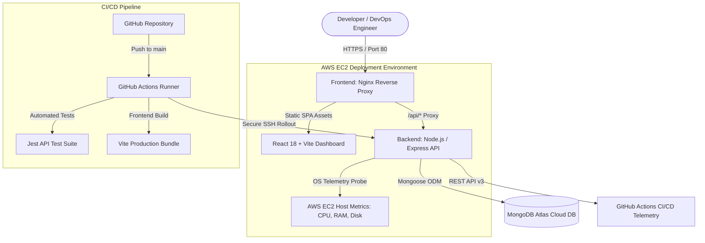

# DevOpsHub — Deployment & Server Management Dashboard

A production-grade, full-stack DevOps management application built with **React (Vite)**, **Node.js (Express)**, **MongoDB Atlas**, **Docker Compose**, and **GitHub Actions CI/CD** for **AWS EC2** hosting. Designed with a Figma/Linear-inspired dark UI.

---

## Architecture Overview



---

## Key Features

1. **Figma-Inspired Black SaaS Dashboard**:
   - Palette: `#09090B` (main bg), `#0C0C0F` (sidebar), `#111114` (cards), `#18181B` (elevated), `#27272A` (borders), `#FAFAFA` (primary text).
   - Fixed/collapsible left navigation sidebar with zero overlap on desktop and responsive slide-out mobile drawer.
   - Clean Inter typography and Lucide React iconography.

2. **Overview Dashboard**:
   - Welcome banner with live system status.
   - Aggregated deployment counters: total deployments, pipeline success rate, and active builds.
   - EC2 instance availability badge and real-time CPU & memory utilization cards.
   - Recent deployment activity table with direct drill-down links.

3. **Deployment Manager (Feature Tab 1)**:
   - Interactive deployment history table with environment, branch, commit SHA, and duration tracking.
   - Real-time status badges: `Success`, `Failed`, `In Progress`, and `Queued`.
   - Granular Deployment Details modal featuring a terminal-style build log viewer.
   - Live GitHub Actions API sync via secure backend endpoints (tokens never exposed to frontend).
   - Interactive "Trigger Deployment" modal with asynchronous pipeline simulation.

4. **EC2 Server Status & Host Telemetry (Feature Tab 2)**:
   - Non-fabricated CPU calculation using delta tick sampling across physical/virtual cores.
   - Real RAM utilization tracking (used GB vs total GB vs percentage).
   - Primary disk usage probe with graceful handling of isolated container boundaries.
   - Clear distinction indicator between Docker Container vs Bare-Metal Host execution.
   - System properties: Hostname, OS platform, architecture, process uptime, and load averages.
   - Public `/api/health` probe for AWS Application Load Balancers and uptime monitors.

5. **Security & Authentication**:
   - Signup, Login, and Logout flows with bcrypt password hashing (10 salt rounds).
   - Stateless JWT tokens passed via `Authorization: Bearer <token>`.
   - Brute-force rate limiting (`express-rate-limit`) on authentication endpoints.
   - Protected client-side routes redirecting unauthenticated traffic to `/login`.
   - Graceful fallback mode enabling zero-configuration local demo testing while awaiting MongoDB Atlas credentials.

6. **Containerization & CI/CD**:
   - Multi-stage Dockerfiles for both backend and frontend.
   - Non-root user permissions inside backend runtime.
   - Nginx reverse proxy serving static SPA assets and proxying `/api` traffic internally.
   - Docker Compose orchestrating isolated internal bridge networking.
   - GitHub Actions workflow (`.github/workflows/ci-cd.yml`) executing tests, Vite build, Docker builds, and automated SSH deployment to EC2.

---

## Project Structure

```text
devopshub/
├── .github/
│   └── workflows/
│       └── ci-cd.yml          # GitHub Actions CI/CD Pipeline
├── backend/
│   ├── src/
│   │   ├── config/            # DB connection & environment variables
│   │   ├── controllers/       # Auth, dashboard, deployment, and server logic
│   │   ├── middleware/        # JWT auth, rate limiting, and error handling
│   │   ├── models/            # Mongoose schemas: User, Deployment, ServerMetric
│   │   ├── routes/            # REST API route definitions
│   │   ├── services/          # GitHub API & host metric telemetry
│   │   ├── app.js             # Express app configuration
│   │   └── server.js          # HTTP server entry point
│   ├── tests/
│   │   └── api.test.js        # Automated Jest & Supertest API test suite
│   ├── Dockerfile             # Multi-stage production Dockerfile
│   └── package.json
├── frontend/
│   ├── src/
│   │   ├── components/        # Sidebar, Header, MetricCard, StatusBadge, ProtectedRoute
│   │   ├── context/           # AuthContext & NotificationContext
│   │   ├── layouts/           # DashboardLayout
│   │   ├── pages/             # Login, Signup, Overview, Deployments, ServerStatus, Settings
│   │   ├── services/          # Axios API client
│   │   ├── styles/            # Figma black theme design system (index.css)
│   │   ├── App.jsx            # Router and app hierarchy
│   │   └── main.jsx           # React DOM root
│   ├── nginx.conf             # Nginx reverse proxy and caching configuration
│   ├── Dockerfile             # Multi-stage Nginx + Vite Dockerfile
│   └── package.json
├── docker-compose.yml         # Container orchestration
├── .env.example               # Template environment configuration
├── .gitignore
├── VIVA_GUIDE.md              # Viva explanation & architecture preparation
└── README.md
```

---

## Getting Started Locally

### Prerequisites
- Node.js (v20+ or v22 LTS recommended)
- npm (v10+)
- Docker & Docker Compose (optional, for container runs)

### 1. Clone & Set Up Environment
```bash
cp .env.example .env
```
Edit `.env` to supply your MongoDB Atlas URI, JWT Secret, and GitHub credentials (or leave blank to run in local demo mode).

### 2. Run Backend
```bash
cd backend
npm install
npm test           # Execute automated test suite
npm run dev        # Starts API server on http://localhost:5000
```

### 3. Run Frontend
In a separate terminal:
```bash
cd frontend
npm install
npm run dev        # Starts Vite dev server on http://localhost:5173
```
Visit `http://localhost:5173/` in your browser.

---

## Running with Docker Compose

To test the entire containerized stack locally or on your AWS EC2 instance:

```bash
# Build and start all services in detached mode
docker compose up --build -d

# Check running containers and health status
docker compose ps

# Inspect logs
docker compose logs -f

# Stop containers
docker compose down
```

The frontend will be available at `http://localhost:80/` (or your EC2 public IP), proxying API requests to the backend internally.

---

## AWS EC2 & Cloud Deployment

### 1. EC2 Instance Requirements
- Ubuntu 22.04 LTS or 24.04 LTS (t3.micro or t3.small recommended).
- Inbound Security Group Rules:
  - **SSH (Port 22)**: Restricted to your IP or GitHub Actions IP ranges.
  - **HTTP (Port 80)**: Accessible from anywhere (`0.0.0.0/0`).
  - **HTTPS (Port 443)**: Accessible from anywhere (`0.0.0.0/0`).

### 2. Configure GitHub Repository Secrets
Under your GitHub repository &rarr; **Settings** &rarr; **Secrets and variables** &rarr; **Actions**, configure:
- `EC2_HOST`: Public IPv4 address or Elastic IP of your EC2 instance.
- `EC2_USER`: `ubuntu`
- `EC2_SSH_KEY`: Content of your private SSH key (`.pem` file).
- `MONGODB_URI`: Your MongoDB Atlas connection URI.
- `JWT_SECRET`: Random 32+ character string.

Whenever you push to the `main` branch, the CI/CD pipeline automatically validates tests, builds the assets, connects via SSH to your EC2 instance, updates containers with Docker Compose, and verifies the `/api/health` endpoint.

---

## Future Extensibility: Prometheus & Grafana Roadmap

The backend has been modularized to easily attach Prometheus metrics and Grafana dashboards in future iterations:

1. **Prometheus Metrics Exporter**:
   - Install `prom-client` in the backend.
   - Expose a `/metrics` endpoint with default Node.js GC metrics, event loop lag, and custom counters for HTTP request durations and deployment statuses.
2. **Prometheus Server**:
   - Add a `prometheus` service to `docker-compose.yml` scraping `backend:5000/metrics` every 15 seconds.
3. **Grafana Dashboards**:
   - Add a `grafana` service to `docker-compose.yml` with pre-provisioned data sources and visual dashboards displaying historical CPU, RAM, disk I/O, and deployment failure rates.
